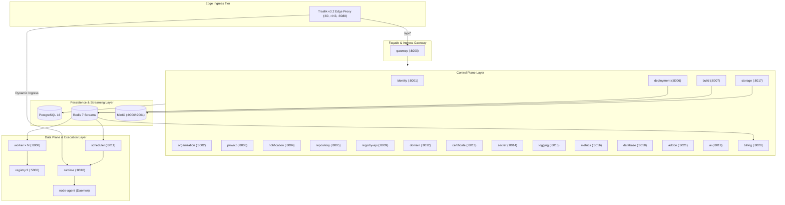

# JP Target Product Architecture

> **Comprehensive architectural specification of the JP open-source self-hosted platform.**  
> Defines the subsystem boundaries, request flow, control plane, node agent, orchestration, and persistence architecture.

---

## 1. Top-Level Architectural Boundaries

JP combines the capabilities of modern PaaS platforms (Vercel, Render, Railway), container orchestrators, and server control panels. It is designed to scale gracefully from a low-overhead single-server deployment to a clustered multi-node infrastructure.

---

## 2. Subsystem Responsibilities

### A. Edge Routing (Traefik v3.2)
- Handles external HTTP (:80) and HTTPS (:443) traffic.
- Exposes internal API traffic matching `PathPrefix('/api')` to `gateway:8000`.
- Continuously watches `/etc/traefik/dynamic/` for dynamic project host ingress configurations synthesized by the `domain` service.
- Terminates TLS with ACME Let's Encrypt automated challenge resolution.

### B. Façade Gateway (`gateway`)
- Acts as the single public entry point for all API operations.
- Intercepts requests, validates access tokens, and converts Personal Access Tokens (`jp_pat_*`) into short-lived JWTs via `identity:8001`.
- Performs multi-tenant RBAC resolution against `organization:8002`, injecting `X-Org-Role`, `X-Org-ID`, `X-User-ID`, and `traceparent`.
- Strips `/api/v1` path prefixes and dispatches to downstream internal services.

### C. Control Plane Services
- **identity (:8001):** User credentials, bcrypt password hashing, session revocation, PAT management, security audit logs.
- **organization (:8002):** Multi-tenant organizations, invitations, team RBAC roles.
- **project (:8003):** Project entities, `jp.yaml` desired state persistence, canonical hashing, and drift detection.
- **repository (:8005):** GitHub App integrations, OAuth callbacks, repository associations, and HMAC webhook ingestion.
- **deployment (:8006):** Deployment state machine, build coordination, and rollback orchestration.
- **build (:8007):** Build records and log streaming API.
- **secret (:8014):** Multi-environment AES-256-GCM envelope encryption with version history.
- **domain (:8012) & certificate (:8013):** DNS verification and SSL/TLS certificate tracking.
- **database (:8018) & addon (:8021):** One-click managed database and backing service provisioning.
- **storage (:8017):** S3 object storage bucket and file management via MinIO.
- **ai (:8019):** Tool-assisted diagnostic engine utilizing OpenAI API with heuristic fallback.

### D. Data Plane & Orchestration
- **worker (:8008):** Docker BuildKit execution daemon consuming `jp.build` from Redis Streams.
- **registry:2 (:5000) & registry-api (:8009):** OCI image distribution and cataloging.
- **scheduler (:8011):** Coordinates rolling/blue-green updates, garbage collection, and cron tasks.
- **runtime (:8010):** Direct Docker Engine socket orchestrator.
- **node-agent:** Minimal server agent executing authorized desired-state reconciliation.

---

## 3. Operational Deployment Profiles

| Profile | Target Hardware | Included Components | Workload Strategy |
|---|---|---|---|
| **Lite** | 1 GB RAM, 0.5–1 CPU | Gateway, Identity, Org, Project, Deploy, Traefik, PostgreSQL, Redis | Remote builds, external object storage, bounded log retention, simulate mode fallback. |
| **Standard** | 6–16 GB RAM, 4+ CPUs | Full Control Plane + Local Worker + Docker Registry + MinIO S3 + Addons | Local Docker BuildKit builds, local registry, local container runtime. |
| **Cluster** | Multiple Nodes | Multi-Node Agent, External Managed PG/Redis, Distributed Workers | Cluster scheduling, capacity-aware workload placement, automated node recovery. |
